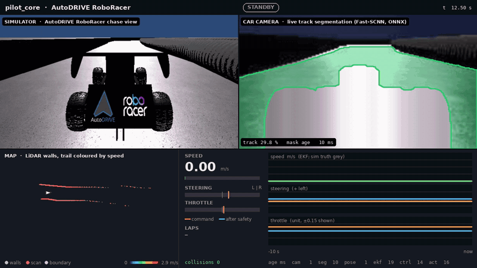
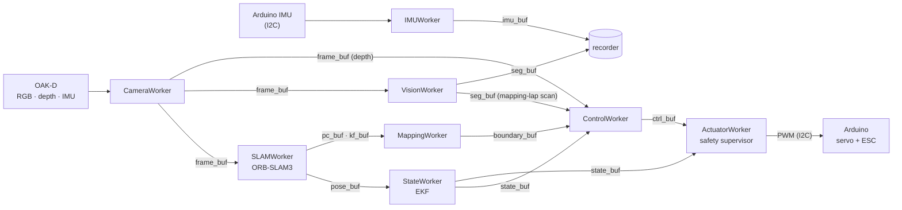

# pilot_core

[](https://github.com/UTASR-UT-Autonomous-Scale-Racing/pilot_core/actions/workflows/ci.yml)


On-vehicle software for UTASR's autonomous scale race car: camera, IMU, SLAM,
mapping, control and actuation, run as Python processes that share data through
shared-memory ring buffers. The same pipeline drives the real car (OAK-D, Jetson,
Arduino) and the AutoDRIVE RoboRacer simulator.



The AutoDRIVE RoboRacer sim at 5× speed. A LiDAR follow-the-gap lap maps the track and closes
the loop, then `pure_pursuit` races the boundary it just extracted (16.73 s, 0 collisions).
Every panel is drawn from the recorded buffers on one clock:

- sim chase view
- car camera with the live Fast-SCNN segmentation
- map built from LiDAR, with the trail coloured by speed
- controller command vs. what the safety supervisor actually sent

Rendered by [`scripts/render_hud.py`](#telemetry-hud). Full-resolution frame: [hud_frame.png](docs/images/hud_frame.png).

| | |
| --- | --- |
| **Sim validation** | link, arming, steering, reset, stop and map-then-race checks pass; 84 benchmark runs, 0 errors ([results](docs/results.md)) |
| **Controllers** | `pure_pursuit`: 12.89 s best practice lap, 0 collisions; `mpc` about 0.25 s per lap slower, with the lowest cross-track error |
| **Vision** | sim track segmentation IoU 0.94 on an unseen track, live in the loop |
| **Safety** | neutral until armed; 150 ms command watchdog; speed cap and slew limits; RC override on the car |

## Quick start

```bash
git clone https://github.com/UTASR-UT-Autonomous-Scale-Racing/pilot_core.git && cd pilot_core
scripts/setup.sh                                   # submodules; --with-slam adds ORB-SLAM3 (docs/slam.md)
python3 -m venv .venv && source .venv/bin/activate
pip install -e ".[test]"                           # ,sim AutoDRIVE, ,plot HUD/figures, ,train torch, ,rl RL

python start.py --config config_cpu.yaml           # OAK-D + map-free control, no actuator output
python start.py --config config_autodrive.yaml     # AutoDRIVE sim (docs/autodrive.md)
```

Keys while running: `a` arm, `SPACE` disarm, `l` end of the mapping lap, `q` quit.
Outputs stay neutral until armed. On the car the actuator is silent on I2C while
disarmed, so the RC transmitter drives (the hand-driven mapping lap), and moving an RC
stick always overrides the Jetson.

## Pipeline



Each box is a process (`workers/`), each arrow a ring buffer (`shared_buffer/`).
`start.py` builds the pipeline from a config, restarts crashed workers (disarming if
the worker is on the command path) and handles the keys. `control/` is a plain library
(controllers, EKF, safety supervisor, bicycle-model simulator).

| Buffer | Contents |
| ------ | -------- |
| `frame_buf` | RGB `uint8` (H, W, 3) + aligned depth `float32` metres |
| `pose_buf` | 4×4 camera-to-world pose, stamped with the frame's capture time |
| `state_buf` | `t, x, y, yaw, v, yaw_rate` (EKF) |
| `ctrl_buf` | steering, throttle in [0, 1], 0.5 = neutral; steering 1 = full right, throttle > 0.5 = forward |
| `imu_buf` | quaternion, acceleration (m/s²), 2 extra channels (Arduino: RC throttle/steering µs) |

All timestamps are on `time.monotonic()`. Controllers use signed units (steering
+1 = left) and `ControlWorker` converts them.

## Control

| `control_mode` | Controller | Needs |
| -------------- | ---------- | ----- |
| `pure_pursuit` (default), `stanley`, `lqr`, `mpc` | Track followers | SLAM + mapped track |
| `policy` | PPO policy (ONNX) from `rl/train.py` | SLAM + mapped track + model |
| `depth_ftg` | Follow-the-Gap on a depth scan | depth camera |
| `bc`, `vae` | Behaviour cloning / VAE policy (ONNX) | depth camera + model |

**No LiDAR on the car.** The follow-the-gap mapping drive (`track_control.mapping_drive`)
takes a 2D scan. In the sim that is the LiDAR's; on the car it is built from the edge of
the segmentation mask and the depth at that edge (`control/seg_scan.py`, `seg_scan:` in the
configs, needs `vision.enabled`). On the sim's showcase run, inside the camera's view, it
places walls within 0.9 cm median (10.9 cm p90) of the LiDAR, misses none within 3 m, and
steers within 0.2° of the LiDAR-driven gap follower ([results](docs/results.md#segmentation-edge-scan)).

Safety supervisor (`control/safety.py`): neutral until armed; commands older than
150 ms, future-stamped or non-finite → neutral throttle; 1.5 m/s speed cap, reverse
cap, slew limits. The firmware ignores Jetson commands older than 250 ms.

Closed-loop bench, same estimator and safety chain on a bicycle model
(`python scripts/sim_bench.py --summary docs/images/controllers.png`):


Training the learned candidates:

```bash
python scripts/train_bc_policy.py --out bc_policy.onnx          # depth -> steering (bc)
python scripts/train_vae_policy.py --out vae_policy.onnx        # (vae)
python rl/train.py && python rl/export_onnx.py --run PPO_N --out policy.onnx   # (policy, AutoDRIVE)
python scripts/train_vision.py --data datasets/track --model fast_scnn          # vision.model: onnx
```

BC/VAE train on depth rendered by the bicycle-model bench (`control/sim.py`); for the real car build `--data` from a recording
(see below).

Before driving: calibrate `track_control.speed.longitudinal.speed_per_throttle`,
measure `vehicle_params.yaml` (F1TENTH placeholders) and the camera height/pitch
(`depth_ftg`), then bench-test arm/disarm and steering direction with the wheels off
the ground.

## Recording

`--recording` writes every active buffer to a timestamped folder under
`recording_path` (one recorder process, every sample read, files rotated after
`top_n` records, `sample_k` keeps every k-th sample). A 640×400 RGB-D frame is 1.8 MB,
so frames are usually sampled (`config.yaml` keeps every 2nd).

```bash
python scripts/read_recording.py <run>                                     # per-buffer summary
python scripts/render_recording.py <run> --out figs/                       # camera, map, track, timeline figures
python scripts/recording_to_dataset.py <run> --bc demos.npz --label-source imu   # BC data from a hand-driven lap
python scripts/recording_to_dataset.py <run> --vision datasets/track --bootstrap-masks
```

## Configuration

| File | Use |
| ---- | --- |
| `config.yaml` | Car (Jetson): I2C actuator, SLAM, `pure_pursuit` |
| `config_cpu.yaml` | Workstation with OAK-D; actuator output disabled |
| `config_autodrive.yaml` | AutoDRIVE RoboRacer Unity sim, direct link on :4567 ([docs/autodrive.md](docs/autodrive.md)) |

`--config` is required; `--enable-slam`, `--recording`, `--control-mode`,
`--oakd-imu` and `--debug` override it. Only `config.yaml` enables I2C; on a desktop
`/dev/i2c-*` are motherboard buses.

## Simulator

`config_autodrive.yaml` runs the whole pipeline against the AutoDRIVE RoboRacer Unity
simulator. pilot_core is the server the sim connects to on port 4567, so no ROS or
bridge is involved. Sensors fill the usual buffers, and the actuator's supervised
command goes back to the sim. A LiDAR follow-the-gap lap maps the track, then the
control mode races on it. Setup on a GPU box, the sim's protocol quirks, calibration
and the benchmark are in [docs/autodrive.md](docs/autodrive.md).

```bash
python start.py --config config_autodrive.yaml      # then: python scripts/autodrive_sim_ctl.py connect
```

Validation and benchmark results: [docs/results.md](docs/results.md).

## Telemetry HUD

Any recorded run can be exported to plain files on one clock and rendered as the HUD
above. In the sim, the screen video is included too; without it, the depth image takes
that panel.

```bash
python scripts/export_recording.py <run> --out <run>/export     # CSV / PNG / NPZ, one clock
python scripts/render_hud.py <run>/export --out hud.mp4         # real time, 1280×720
python scripts/render_hud.py <run>/export --out hud.gif --speed 5 --fps 6 --gif-width 800
```

The export format is documented in [docs/autodrive.md](docs/autodrive.md#telemetry-export-and-hud).
The README run's export is in the `telemetry-showcase` bundle ([docs/datasets.md](docs/datasets.md)).

## Data and models

Trained models and datasets are kept out of git. The ONNX models, RL checkpoints, sim
segmentation dataset and showcase telemetry are packaged as release bundles. Their
contents, checksums, rebuild commands and the data still to collect are in
[docs/datasets.md](docs/datasets.md).

## Repository layout

| Path | Contents |
| ---- | -------- |
| `start.py` | Entry point: builds the pipeline from a config, supervises workers, handles keys |
| `workers/` | One process per stage (camera, IMU, SLAM, LiDAR, state, mapping, vision, control, actuator, AutoDRIVE link, recorder) |
| `shared_buffer/` | Shared-memory ring buffers, one typed buffer per stream |
| `control/` | Controllers, EKF, safety supervisor, bicycle-model sim (plain library) |
| `vision/` | Track segmentation models, training and inference |
| `rl/` | PPO training: bicycle-model pretraining and the live-sim `TrackEnv` |
| `scripts/` | Setup, benchmark, calibration, training, recording and rendering tools |
| `tests/` | pytest suite; `fake_autodrive.py` stands in for the sim |
| `bench/` | Benchmark matrix and dated result tables |
| `maps/` | Saved track boundaries for the sim tracks |
| `sim_camera/` | Sim camera intrinsics, car-body mask, ORB-SLAM3 settings |
| `config*.yaml`, `vehicle_params*.yaml` | Run configs and vehicle models (see Configuration) |
| `docs/` | Guides, results, roadmap |
| `ORB_SLAM3/`, `firmware/` | Submodules: the SLAM fork and the Arduino firmware |

## Development

```bash
python -m pytest -m "not oakd and not slam"                     # hardware-free suite (CI)
OAKD_AVAILABLE=1 python -m pytest -m oakd                       # with an OAK-D on USB 3
python -m pyflakes control vision workers shared_buffer rl scripts tests start.py
```

## Documentation

| Guide | |
| ----- | - |
| [docs/autodrive.md](docs/autodrive.md) | AutoDRIVE sim: setup, protocol, calibration, benchmark, vision, telemetry export |
| [docs/results.md](docs/results.md) | Sim validation and benchmark results |
| [docs/oakd.md](docs/oakd.md) | OAK-D bench check, USB 3 requirement, open camera items |
| [docs/slam.md](docs/slam.md) | ORB-SLAM3 build and the Python wrapper |
| [docs/deployment.md](docs/deployment.md) | Running on the Jetson, natively or in Docker |
| [docs/datasets.md](docs/datasets.md) | Data and model bundles, and what is still to collect |
| [docs/roadmap.md](docs/roadmap.md) | What is next |
| `firmware/README.md` | Arduino firmware and the I2C interface |

## License

[Apache-2.0](LICENSE). ORB-SLAM3 (submodule, linked by `orbslam3_wrapper`) is GPLv3.
