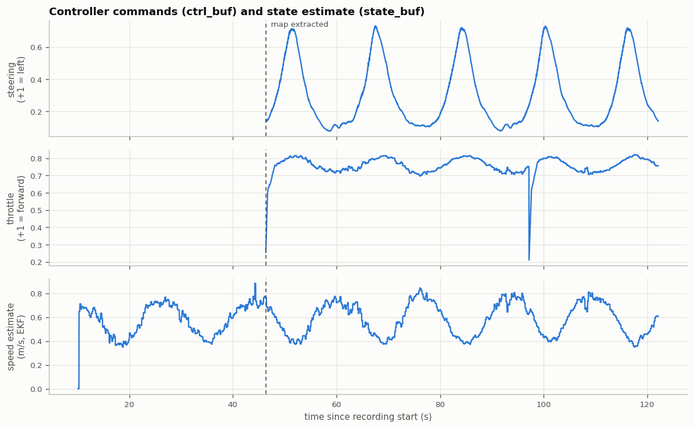

# pilot_core

The on-vehicle software for UTASR's autonomous scale race car. It runs the full
pipeline (camera, IMU, SLAM, mapping, control and actuation) as a set of Python
processes that exchange data through shared-memory ring buffers.

## Quick start

On a workstation (CPU only) with an OAK-D camera plugged in:

```bash
git clone https://github.com/UTASR-UT-Autonomous-Scale-Racing/pilot_core.git
cd pilot_core
scripts/setup.sh                    # firmware submodule; add --with-slam for ORB-SLAM3

python3 -m venv .venv && source .venv/bin/activate
pip install -e ".[test]"            # or: pip install -r requirements.txt

python start.py --config config_cpu.yaml           # camera + map-free control, actuator disabled
```

No camera? `python start.py --config config_dev_local.yaml` runs the same pipeline
on a simulated track ([a full run in the dev simulator](#a-full-run-in-the-dev-simulator)).

While it runs, the terminal takes single-key commands:

| Key     | Action |
| --- | ------ |
| `a`     | **Arm**: actuator outputs follow the controller |
| `SPACE` | **Disarm**: outputs go to neutral immediately (any key other than `a`/`l`/`q`) |
| `l`     | Signal loop closure at the end of the hand-driven mapping lap |
| `q`     | Quit (or **Ctrl+C**) |

Outputs stay neutral until you arm. On the car the actuator sends nothing over I2C
while disarmed, so the RC transmitter drives (the hand-driven mapping lap), and moving
an RC stick always takes over from the Jetson (`firmware/README.md`).

## How it works

```
 OAK-D ──▶ CameraWorker ──frame_buf──▶ VisionWorker ──seg_buf──▶ (recording / telemetry, optional)
  RGB, depth,   │
  IMU           ├──frame_buf──▶ SLAMWorker ──pose_buf──▶ StateWorker ──state_buf──┐
                │                  │                                             ▼
                │                  └──pc_buf──▶ MappingWorker ──boundary_buf──▶ ControlWorker ──ctrl_buf──▶ ActuatorWorker ──▶ Arduino (I2C)
                └──frame_buf (depth) ─────────────────────────────────────────▶ (map-free modes)            safety supervisor
```

- `start.py` reads a config, creates the buffers, spawns the workers, restarts
  crashed workers (up to 3 times, disarming if the worker is on the command path),
  handles operator keys and shuts everything down.
- Every worker (`workers/`) is a process with a `setup()` → `step()` loop → `teardown()` lifecycle.
- `control/` is a plain Python library (no processes, no shared memory) holding
  all control algorithms, the state estimator, the safety supervisor and a closed-loop
  simulator used for tests and benchmarks.

Data contracts between workers:

| Buffer       | Contents |
| ------ | -------- |
| `frame_buf`  | RGB `uint8` (H, W, 3) and depth in metres `float32` (H, W), aligned |
| `imu_buf`    | `[qw, qx, qy, qz, ax, ay, az, s7, s8]`, acceleration in m/s². Arduino IMU: s7/s8 = RC throttle/steering pulse widths (µs); OAK-D IMU: gyro rates (quaternion NaN on IMUs without a rotation vector) |
| `pose_buf`   | 4×4 camera-to-world pose, stamped with the frame's capture time; published only while SLAM is tracking |
| `state_buf`  | `t, x, y, yaw, v, yaw_rate` on the ground plane (EKF estimate) |
| `ctrl_buf`   | `steering, throttle` in [0, 1], 0.5 = neutral. Steering 0 = full left, 1 = full right; throttle below 0.5 = backward, above = forward |

Controllers work in signed units (steering +1 = left, throttle +1 = forward) and
`ControlWorker` converts them to `ctrl_buf`. `ActuatorWorker` turns `ctrl_buf`
into servo/ESC pulse widths (config section `pwm`).

## A full run in the dev simulator

Everything below comes from one run of the real pipeline, with no hardware, on the
4-core CPU workstation:

```bash
python start.py --config config_dev_local.yaml --enable-slam --control-mode pure_pursuit --recording
python scripts/render_recording.py /tmp/pilot_recordings/<run> --out docs/images --truth config_dev_local.yaml
```

The synthetic camera (`synthetic_scene: track`) ray-casts a closed track of textured
walls and floor, with the camera 0.15 m up and pitched 12° down, and drives a scripted
lap. That lap stands in for the hand-driven mapping lap. The frames go through the same
workers as on the car: ORB-SLAM3, the state estimator, mapping, vision, control, the
safety supervisor and the (dummy) actuator. `render_recording.py` builds every figure
from the recording alone; with `--truth` it also compares against the simulator's
ground truth.

> The scripted camera does not respond to the commands, so the run is open loop.
> Closed-loop driving is shown on the right of the track figure, where the bicycle-model
> simulator from `control/sim.py` drives the **mapped** track and is scored against the
> **true** walls.

**What the car sees:** RGB and aligned depth, the drivable-track mask from
`vision.model: ground_plane`, and the virtual laser scan `depth_ftg` builds from the
depth image, with the gap it steers for.


**Track mapping.** ORB-SLAM3 closed the loop by itself after one lap. `SLAMWorker`
signals the loop only once the global bundle adjustment has finished, so mapping uses
the optimised map. `MappingWorker` then takes the loop-corrected keyframe trajectory,
keeps map points above the floor plane and near the driven line, and places each wall
at the nearest dense layer of points along the lap. Dashed lines are the true walls.


**The mapped track as the controllers use it.** The mapped track becomes a
`TrackModel` with a centre line and a speed profile (left). On the right, a simulated
car drives it with `pure_pursuit`.


**Commands over the run.** No command is sent until the map exists. Once mapping
completes, SLAM switches to localization and `pure_pursuit` steers through each bend of
the lap.



Measured against the simulator's ground truth, for this run and a repeat run:

| | Run shown | Repeat run |
| --- | --- | --- |
| Floor fit (camera pitch, height; true 12°, 0.15 m) | 12.0°, 0.150 m | 12.0°, 0.150 m |
| SLAM trajectory error (RMS) | 1.0 cm (677 poses) | 1.4 cm (647 poses) |
| Extracted boundaries vs true walls (median / 95th pct / max) | 1.2 / 3.5 / 5.9 cm | 1.2 / 4.4 / 14.6 cm |
| Simulated drive on the mapped track | 3 laps, cross-track RMS 4.8 cm, inside the true walls 100 % | 3 laps, 4.9 cm, 100 % |
| Frame rate, SLAM + vision + mapping + control on 4 CPU cores | 6.0 FPS | 6.0 FPS |

The frame rate is set by the synthetic renderer (about 150 ms per frame), not the pipeline.

## Control

After a hand-driven mapping lap (`--enable-slam`, then `l`), the track controllers
follow the mapped centre-line. The map-free controllers drive from the depth image alone.

| `control_mode` | Controller | Needs |
| -------------- | ---------- | ----- |
| `pure_pursuit` (default) | Pure Pursuit | SLAM + mapped track |
| `stanley` | Stanley | SLAM + mapped track |
| `lqr` | Speed-scheduled LQR | SLAM + mapped track |
| `mpc` | Linear time-varying MPC | SLAM + mapped track |
| `policy` | Trained PPO policy (ONNX) | SLAM + mapped track + model |
| `depth_ftg` | Follow-the-Gap on a depth-image scan | depth camera |
| `bc` | Behaviour-cloning CNN (ONNX) | depth camera + model |
| `vae` | VAE latent + steering head (ONNX) | depth camera + model |

Every command passes a **safety supervisor**. Outputs are neutral while disarmed. With no fresh
(or a non-finite) command for 150 ms, throttle goes neutral and the car coasts to a stop.
Speed is capped at 1.5 m/s, reverse throttle is capped, and steering and throttle changes
are rate-limited. The Arduino adds its own 250 ms timeout on Jetson commands.

See [docs/control.md](docs/control.md) for the conventions, tuning, the
closed-loop bench, training the learned models, and the checklist before driving
the car. Algorithm references are in [docs/references.md](docs/references.md).

## Vision

`VisionWorker` publishes a drivable-track mask (1 = track, 0 = everything else) to
`seg_buf` when `vision.enabled` is set (nothing consumes the mask yet, so it is off by
default). The segmenter is set by `vision.model`: the training-free `ground_plane`
(RANSAC floor + free space from depth, default) or a candidate network trained with
`scripts/train_vision.py` (`onnx`: Fast-SCNN, LR-ASPP, DeepLabV3, U-Net).
See [docs/vision.md](docs/vision.md).

## Recording, streaming and sampling

**Recording.** `--recording` (or `recording: true`) starts one recorder process that
streams every active buffer to disk while the car runs. It writes one file series per
buffer into a timestamped folder under `recording_path`. The recorder reads *every*
sample still in each ring buffer, not only the newest, so fast producers are not
undersampled; any sample overwritten before it could be read is counted and reported.
The dev run above recorded:

| Buffer | Records | Rate | Size | Contents |
| ------ | ------- | ---- | ---- | -------- |
| `frame` | 731 | 6.0 Hz | 1310 MB | RGB + depth |
| `segmentation` | 730 | 6.0 Hz | 187 MB | drivable-track mask (uint8) |
| `pose` | 677 | 6.0 Hz | < 0.1 MB | SLAM pose, stamped with the frame's capture time |
| `state` | 5310 | 47 Hz | 0.1 MB | EKF state `x, y, yaw, v, yaw_rate` |
| `control` | 3594 | 47 Hz | < 0.1 MB | steering / throttle commands |
| `imu` | 22732 | 185 Hz | 0.8 MB | IMU |
| `pointcloud` | 26 | 0.2 Hz | 4.0 MB | SLAM map points (every 30 frames, and once the loop closure is optimised) |
| `keyframes` | 26 | 0.2 Hz | < 0.1 MB | loop-corrected keyframe trajectory |
| `boundary` | 1 | once | < 0.1 MB | extracted track boundaries |

No sample was dropped in any buffer.

Every buffer is stamped on the same monotonic clock, so records from different
buffers can be matched by time. That's how the figures pair each frame with its
command, and each pose with its ground truth.

**Sampling.** Frames dominate the disk use (a 640×400 RGB-D frame is 1.8 MB: about 11 MB/s at
6 FPS, 55 MB/s at 30 FPS), so they are sampled at several levels:

| Where | Setting | Effect |
| ----- | ------- | ------ |
| Recording | `recording_config.<buffer>.sample_k` | keep every k-th sample (`config.yaml` keeps every 2nd frame) |
| Recording | `top_n`, `on_full: rotate`, `keep_files` | start a new file after `top_n` records and keep the newest `keep_files`, which bounds disk use on long runs; `on_full: stop` stops instead |
| Rendering | `render_recording.py --stride N` | the frame sheet shows every N-th recorded frame (default: 8 spread over the run) |
| Datasets | `recording_to_dataset.py --stride N` | export every N-th frame |
| SLAM map | every 30 frames, and once a loop closure is optimised | map points are republished occasionally, not per frame |


**Live streaming.** In the simulator, `zmq_publish` streams telemetry (pose, boundaries,
map points, segmentation) on port 5557 while the car drives, and the actuator streams
its commands on 5556 ([docs/simulator.md](docs/simulator.md)).

**Reading and using recordings:**

```bash
python scripts/read_recording.py /tmp/pilot_recordings/<run>                  # per-buffer summary
python scripts/render_recording.py /tmp/pilot_recordings/<run> --out figs/    # the figures above
python scripts/recording_to_dataset.py /tmp/pilot_recordings/<run> --bc demos.npz --label-source imu
python scripts/recording_to_dataset.py /tmp/pilot_recordings/<run> --vision datasets/track --bootstrap-masks
```

`recording_to_dataset.py` builds a behaviour-cloning `.npz` or an `images/` + `masks/`
segmentation dataset ([docs/control.md](docs/control.md#behaviour-cloning-bc-and-vae-vae),
[docs/vision.md](docs/vision.md)).

## Configuration

| File | Use |
| ---- | --- |
| `config.yaml` | On the car (Jetson): I2C actuator, SLAM, `pure_pursuit` |
| `config_cpu.yaml` | Workstation: real OAK-D, CPU, **actuator output disabled** |
| `config_dev_local.yaml` | No hardware: synthetic camera (ray-cast closed track) and IMU |
| `config_zmq.yaml` | AutoDRIVE simulator ([docs/simulator.md](docs/simulator.md)) |
| `vehicle_params.yaml` | Vehicle geometry and limits (F1TENTH placeholders until measured) |

`--config` is required. Command-line flags override the config: `--enable-slam`,
`--recording`, `--control-mode`, `--oakd-imu`, `--debug`.

> **Safety:** only `config.yaml` enables I2C. On a laptop or desktop, `/dev/i2c-*`
> are motherboard buses, not the car's Arduino, so never point the actuator at them.

Hardware notes:
- Only one process can open the OAK-D, so with `use_oakd_imu: true` its IMU is
  streamed by `CameraWorker`.
- Use a USB 3 port and cable for the OAK-D. On USB 2 the link is slower and less reliable.
- `threads_per_worker` (default 1) stops the worker processes from oversubscribing small CPUs.

## Development

```bash
PILOT_SYNTHETIC=1 python -m pytest                               # full suite, no hardware
python scripts/sim_bench.py                                      # controller benchmarks
OAKD_AVAILABLE=1 python -m pytest tests/test_workers.py tests/test_pipeline_integration.py -k "oakd or camera or slam"
```

The ORB-SLAM3 tests run once SLAM is built ([docs/slam.md](docs/slam.md)).
A new controller usually means adding a class in `control/`, registering its
`control_mode` in `ControlWorker`, and adding a bench test. See
[docs/control.md](docs/control.md#adding-a-controller).

### Repository layout

```
start.py              orchestrator (entry point)
control/              control library: track model, controllers, EKF, safety, learned models, bench
vision/               drivable-track segmentation: candidate networks, training, segmenters
workers/              pipeline worker processes
shared_buffer/        shared-memory ring buffers
synthetic/            synthetic camera / IMU / track data for tests
orbslam3_wrapper/     pybind11 bindings for ORB-SLAM3
rl/                   PPO training in AutoDRIVE + ONNX export
scripts/              launch, deployment, benchmark and training scripts
tests/                pytest suite
docs/                 control, vision, SLAM, simulator, deployment, references
submodules            ORB_SLAM3, firmware (Arduino)
```

### Scripts

| Script | Purpose |
| ------ | ------- |
| `scripts/run.sh [args]` | Activate `.venv`, set `LD_LIBRARY_PATH`, run `start.py` |
| `scripts/dev_run.sh [args]` | `run.sh` with `config_cpu.yaml --debug` |
| `scripts/jetson_run.sh` | On the car: performance mode, fast-forward, pinned submodules, launch |
| `scripts/start.sh` | Jetson Docker deployment ([docs/deployment.md](docs/deployment.md)) |
| `scripts/gen_orbslam_settings.py` | ORB-SLAM3 camera settings from the OAK-D calibration |
| `scripts/sim_bench.py` | Closed-loop controller benchmarks |
| `scripts/train_bc_policy.py`, `train_vae_policy.py` | Train the learned depth controllers |
| `scripts/train_vision.py` | Train a drivable-track segmentation network |
| `scripts/vision_bench.py` | Size and latency of the segmentation candidates |
| `scripts/read_recording.py` | Summarise / iterate a recording |
| `scripts/render_recording.py` | Figures from a recording: car view, map, track, frames, timeline |
| `scripts/recording_to_dataset.py` | Recording → BC `.npz` or vision `images/` + `masks/` |
| `scripts/collect_frames.py` | Save simulator camera frames |
| `scripts/setup.sh [--with-slam]` | Initialise the submodules (ORB_SLAM3 only with `--with-slam`) |
| `scripts/branch_checkout.sh [branch]` | Check out a branch in pilot_core and its submodules |

### Containers

| Image | Use |
| ----- | --- |
| `Dockerfile` | Jetson (JetPack 6, NVIDIA runtime) with ORB-SLAM3 built in (`--target noslam` skips it); entrypoint `start.py` |
| `Dockerfile.dev-local` | Lightweight synthetic-only test container (`.devcontainer/dev-local/`) |

CI (`.github/workflows/ci.yml`) runs pyflakes and the hardware-free test suite.

## License

No license has been chosen yet. Note that ORB-SLAM3 (submodule, linked by
`orbslam3_wrapper`) is GPLv3.
