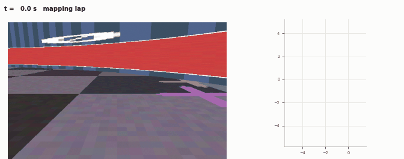
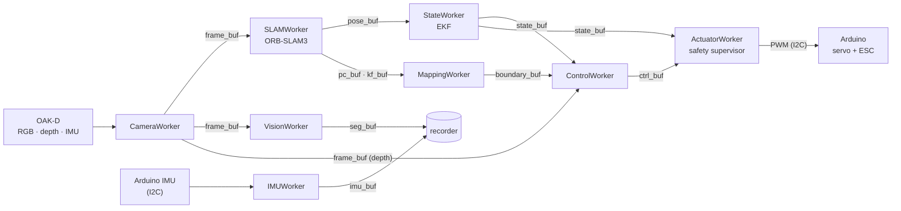
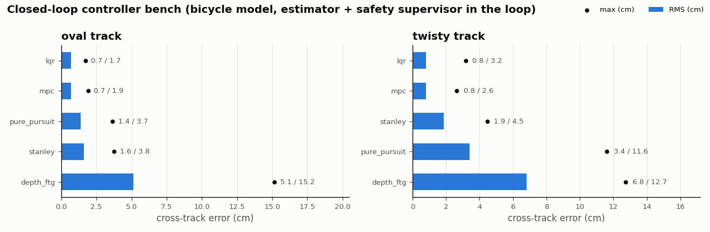
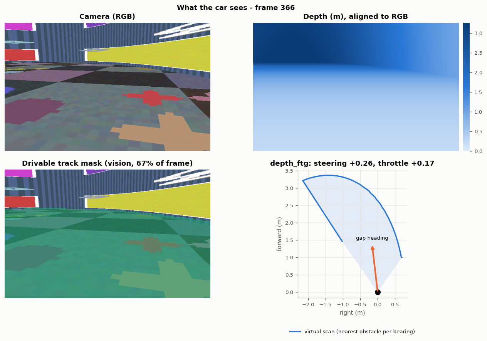
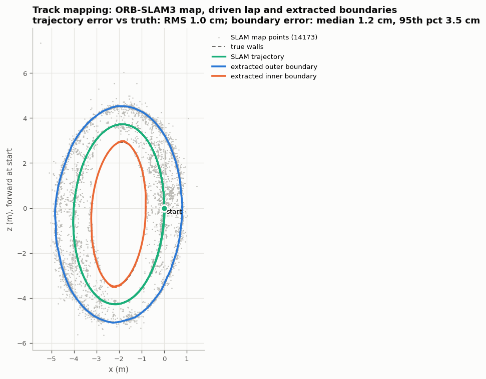
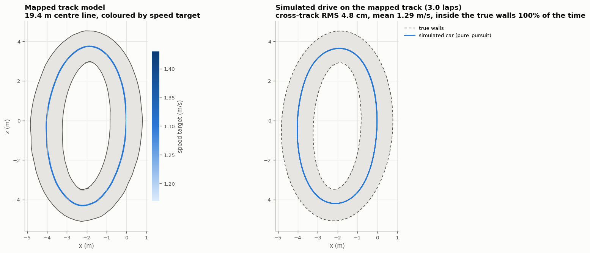
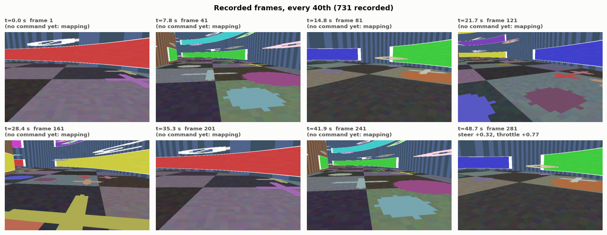

# pilot_core

On-vehicle software for UTASR's autonomous scale race car: camera, IMU, SLAM,
mapping, control and actuation, run as Python processes that share data through
shared-memory ring buffers.



## Quick start

```bash
git clone https://github.com/UTASR-UT-Autonomous-Scale-Racing/pilot_core.git && cd pilot_core
scripts/setup.sh                                   # submodules; --with-slam adds ORB-SLAM3 (docs/slam.md)
python3 -m venv .venv && source .venv/bin/activate
pip install -e ".[test]"                           # ,train for torch models, ,rl for RL

python start.py --config config_cpu.yaml           # OAK-D + map-free control, no actuator output
python start.py --config config_dev_local.yaml     # no hardware: simulated track
```

Keys while running: `a` arm, `SPACE` disarm, `l` end of the mapping lap, `q` quit.
Outputs stay neutral until armed. On the car the actuator is silent on I2C while
disarmed, so the RC transmitter drives (the hand-driven mapping lap), and moving an RC
stick always overrides the Jetson.

## Pipeline



Each box is a process (`workers/`), each arrow a ring buffer (`shared_buffer/`).
`start.py` builds the pipeline from a config, restarts crashed workers (disarming if
the worker is on the command path) and handles the keys. `control/` is a plain library
(controllers, EKF, safety supervisor, bicycle-model simulator).

| Buffer | Contents |
| ------ | -------- |
| `frame_buf` | RGB `uint8` (H, W, 3) + aligned depth `float32` metres |
| `pose_buf` | 4×4 camera-to-world pose, stamped with the frame's capture time |
| `state_buf` | `t, x, y, yaw, v, yaw_rate` (EKF) |
| `ctrl_buf` | steering, throttle in [0, 1], 0.5 = neutral; steering 1 = full right, throttle > 0.5 = forward |
| `imu_buf` | quaternion, acceleration (m/s²), 2 extra channels (Arduino: RC throttle/steering µs) |

All timestamps are on `time.monotonic()`. Controllers use signed units (steering
+1 = left) and `ControlWorker` converts them.

## Control

| `control_mode` | Controller | Needs |
| -------------- | ---------- | ----- |
| `pure_pursuit` (default), `stanley`, `lqr`, `mpc` | Track followers | SLAM + mapped track |
| `policy` | PPO policy (ONNX) from `rl/train.py` | SLAM + mapped track + model |
| `depth_ftg` | Follow-the-Gap on a depth scan | depth camera |
| `bc`, `vae` | Behaviour cloning / VAE policy (ONNX) | depth camera + model |

Safety supervisor (`control/safety.py`): neutral until armed; commands older than
150 ms, future-stamped or non-finite → neutral throttle; 1.5 m/s speed cap, reverse
cap, slew limits. The firmware ignores Jetson commands older than 250 ms.

Closed-loop bench, same estimator and safety chain on a bicycle model
(`python scripts/sim_bench.py --summary docs/images/controllers.png`):



Training the learned candidates:

```bash
python scripts/train_bc_policy.py --out bc_policy.onnx          # depth -> steering (bc)
python scripts/train_vae_policy.py --out vae_policy.onnx        # (vae)
python rl/train.py && python rl/export_onnx.py --run PPO_N --out policy.onnx   # (policy, AutoDRIVE)
python scripts/train_vision.py --data datasets/track --model fast_scnn          # vision.model: onnx
```

BC/VAE train on rendered depth; for the real car build `--data` from a recording
(see below).

Before driving: calibrate `track_control.speed.longitudinal.speed_per_throttle`,
measure `vehicle_params.yaml` (F1TENTH placeholders) and the camera height/pitch
(`depth_ftg`), then bench-test arm/disarm and steering direction with the wheels off
the ground.

## Dev simulator run

The dev simulator (`config_dev_local.yaml`, `synthetic_scene: track`) ray-casts a
closed track with the camera 0.15 m up and pitched 12° down, and drives a scripted lap
through the same workers as the car. The camera path is scripted (open loop); closed
loop is shown with the bicycle model on the mapped track.

```bash
python start.py --config config_dev_local.yaml --enable-slam --control-mode pure_pursuit --recording
python scripts/render_recording.py /tmp/pilot_recordings/<run> --out docs/images --truth config_dev_local.yaml --gif
```

What the car sees: RGB, depth, the `ground_plane` drivable mask and the `depth_ftg` scan.



Track mapping: ORB-SLAM3 map points, the driven lap and the extracted boundaries
(true walls dashed).



The mapped track as the controllers use it, and a simulated `pure_pursuit` drive on it.



| Against ground truth | Run shown | Repeat |
| --- | --- | --- |
| Floor fit (true 12°, 0.15 m) | 12.0°, 0.150 m | 12.0°, 0.150 m |
| SLAM trajectory RMS | 1.0 cm | 1.4 cm |
| Boundaries vs true walls (median / 95th pct) | 1.2 / 3.5 cm | 1.2 / 4.4 cm |
| Simulated drive on the mapped track | 3 laps, 4.8 cm RMS, 100 % inside | 3 laps, 4.9 cm, 100 % |

6 FPS on 4 CPU cores, limited by the synthetic renderer.

## Recording

`--recording` writes every active buffer to a timestamped folder under
`recording_path` (one recorder process, every sample read, files rotated after
`top_n` records, `sample_k` keeps every k-th sample). A 640×400 RGB-D frame is 1.8 MB,
so frames are usually sampled (`config.yaml` keeps every 2nd).

```bash
python scripts/read_recording.py <run>                                     # per-buffer summary
python scripts/render_recording.py <run> --out figs/                       # the figures above
python scripts/recording_to_dataset.py <run> --bc demos.npz --label-source imu   # BC data from a hand-driven lap
python scripts/recording_to_dataset.py <run> --vision datasets/track --bootstrap-masks
```



## Configuration

| File | Use |
| ---- | --- |
| `config.yaml` | Car (Jetson): I2C actuator, SLAM, `pure_pursuit` |
| `config_cpu.yaml` | Workstation with OAK-D; actuator output disabled |
| `config_dev_local.yaml` | No hardware: simulated track |
| `config_zmq.yaml` | AutoDRIVE simulator (sensors on ZMQ 5555, commands 5556, telemetry 5557) |

`--config` is required; `--enable-slam`, `--recording`, `--control-mode`,
`--oakd-imu` and `--debug` override it. Only `config.yaml` enables I2C; on a desktop
`/dev/i2c-*` are motherboard buses.

## Development

```bash
PILOT_SYNTHETIC=1 python -m pytest            # hardware-free suite (CI)
OAKD_AVAILABLE=1 python -m pytest tests/test_workers.py tests/test_pipeline_integration.py
```

SLAM build: [docs/slam.md](docs/slam.md). Jetson deployment: [docs/deployment.md](docs/deployment.md).
Firmware interface: `firmware/README.md`.

## License

Not chosen yet. ORB-SLAM3 (submodule, linked by `orbslam3_wrapper`) is GPLv3.
