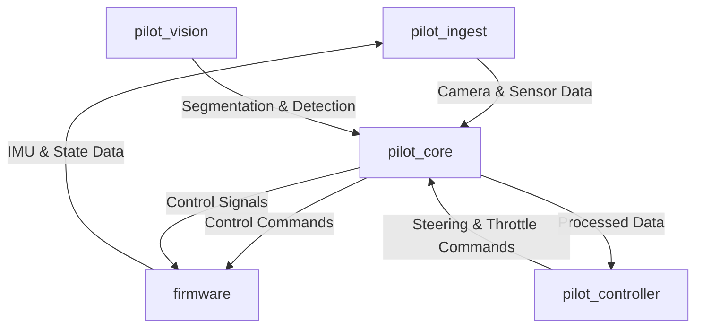

# UTASR Pilot Core

This repository serves as the central control hub for UTASR's autonomous scale racing project. It coordinates the various components of the RC-car including sensor data collection, vision processing, and control logic to enable autonomous racing.

## System Overview

`pilot_core` integrates multiple specialized modules to create a complete autonomous racing system:

- **[`pilot_ingest`](https://github.com/UTASR-UT-Autonomous-Scale-Racing/pilot_ingest)**: Handles sensor data acquisition and processing
- **[`pilot_vision`](https://github.com/UTASR-UT-Autonomous-Scale-Racing/pilot_vision)**: Processes camera data for lane/object detection
- **[`pilot_controller`](https://github.com/UTASR-UT-Autonomous-Scale-Racing/pilot_controller)**: Implements control algorithms to steer the car
- **`firmware`**: Interfaces with the RC-car hardware (servos, ESC, IMU)

## System Architecture



## How It Works

1. **Data Acquisition** ([`pilot_ingest`](pilot_ingest )):
   - Captures camera frames from OAK-D camera
   - Reads IMU data (acceleration, orientation) from the car
   - Processes raw sensor data into structured state vectors

2. **Vision Processing** ([`pilot_vision`](pilot_vision )):
   - Performs lane detection and segmentation on camera frames
   - Identifies track boundaries and obstacles
   - Generates a spatial understanding of the environment

3. **Control Logic** ([`pilot_controller`](pilot_controller )):
   - Takes processed sensor and vision data as input
   - Uses machine learning models to determine optimal control actions
   - Generates steering and throttle commands for the car

4. **Command Execution** ([`firmware`](firmware )):
   - Receives control commands from the Jetson via I2C
   - Controls the car's steering servo and ESC (throttle)
   - Sends sensor data back to the system

## Setup and Installation

1. Clone this repository:
   ```bash
   git clone https://github.com/UTASR-UT-Autonomous-Scale-Racing/pilot_core.git
   cd pilot_core
   ```

2. Run the setup script to clone all required component repositories:
   ```bash
   chmod +x setup.sh
   ./setup.sh
   ```

3. Install dependencies according to the instructions in each component's README.

## Running the System

For development and testing:
```bash
chmod +x dev_run.sh
./dev_run.sh
```

For deployment on the Jetson platform:
```bash
chmod +x jetson_run.sh
./jetson_run.sh
```

The system uses configuration files ([`config.yaml`](config.yaml )) to specify paths to component-specific configurations.

## Hardware Requirements

- NVIDIA Jetson Orin NX (or compatible) embedded AI computer
- Arduino Nano ESP32 (for firmware)
- OAK-D camera for vision processing
- RC car chassis with servo and ESC controllers
- IMU sensor for orientation and acceleration data

## Troubleshooting

For detailed logs and debugging information, check the console output when running the system. Each component has its own logging system that provides information about its operational status.

## More Information

For detailed documentation and usage instructions for each component, please refer to their respective repositories linked above.
