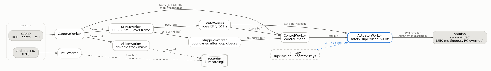

# Architecture

pilot_core is a set of worker processes that exchange data through shared-memory
ring buffers. `start.py` creates the buffers, spawns the workers, watches them and
handles the operator's keys. This page covers what runs where, at what rate, on
which clock, and what happens when something fails.

(Source: [pipeline.dot](pipeline.dot); `dot -Tpng -Gdpi=110 docs/pipeline.dot -o docs/images/pipeline.png`.)

## Processes

| Worker | Reads | Writes | Rate | Notes |
| ------ | ----- | ------ | ---- | ----- |
| `CameraWorker` | OAK-D (or the synthetic camera) | `frame_buf` (+ `imu_buf` with the OAK-D IMU) | camera FPS | frames stamped with the device capture time; re-opens the camera on errors |
| `IMUWorker` | Arduino over I2C | `imu_buf` | 100 Hz | 60-byte telemetry frame; skipped with `use_oakd_imu` |
| `SLAMWorker` | `frame_buf` | `pose_buf`, `pc_buf`, `kf_buf` | per frame | ORB-SLAM3 RGB-D; floor-levelled world frame; poses carry the frame's capture time |
| `MappingWorker` | `pose_buf`, `pc_buf`, `kf_buf` | `boundary_buf` | per update | extracts the track boundaries after the loop closure |
| `StateWorker` | `pose_buf` | `state_buf` | 50 Hz | pose EKF; stops publishing 0.5 s after the last pose |
| `VisionWorker` | `frame_buf` | `seg_buf` | per frame | drivable-track mask; off unless `vision.enabled` |
| `ControlWorker` | `state_buf` + `boundary_buf`, or `frame_buf` | `ctrl_buf` | per state / frame | one `control_mode`; controllers reset while disarmed |
| `ActuatorWorker` | `ctrl_buf`, `state_buf` | I2C (Arduino) and/or ZMQ (simulator) | 50 Hz | safety supervisor; I2C silent while disarmed |
| `BufferRecorderWorker` | every active buffer | files | continuous | only with `--recording` |
| `ZMQSensorWorker`, `ZMQPublishWorker`, `LidarProjectionWorker` | simulator | the sensor buffers / telemetry | | AutoDRIVE only |

Measured in the dev-simulator run from the README: frames, poses and masks at
6 Hz (limited by the synthetic renderer), state and commands at 47 Hz, IMU at 185 Hz.

## Shared-memory buffers

Each buffer is a ring of fixed-size slots with a single writer and any number of
readers (`shared_buffer/ring_buffer.py`). A slot is published with a seqlock: the
header's sequence number is cleared, the payload written, then a trailing copy of
the sequence number, then the header's. A reader accepts a slot only if all three
agree, so it never returns a half-written record. Readers either take the newest
record (`read_latest`), check for new data without copying (`latest_seq`), or take
every record newer than one they have seen (`read_since`, used by the recorder).

| Buffer | Payload | Slots (`config.yaml`) |
| ------ | ------- | --------------------- |
| `frame_buf` | RGB `uint8` (H, W, 3) + depth `float32` metres (H, W) | 8 |
| `imu_buf` | 9 floats: quaternion, acceleration (m/s²), 2 extra channels | 32 |
| `seg_buf` | `uint8` mask (H, W), 1 = drivable track | 4 |
| `pose_buf` | 4×4 camera-to-world pose (+ tracked points) | 8 |
| `state_buf` | `t, x, y, yaw, v, yaw_rate` | 8 |
| `ctrl_buf` | steering, throttle in [0, 1], 0.5 = neutral | 8 |
| `pc_buf` / `kf_buf` | SLAM map points / keyframe positions (N × 3) | 4 / 2 |
| `boundary_buf` | outer and inner boundary (N × 2 each) | 2 |

## Time

Every buffer record carries `produced_ts` on the `time.monotonic()` clock. Sensors
stamp the capture time instead of the write time: DepthAI's device timestamps are
on the host's steady clock, which is the same clock on Linux. So a pose is stamped with
the capture time of the frame it came from, and the EKF, the watchdog and the
recordings all compare times on one clock. `time.time()` is used only for file names.

## Worker lifecycle and supervision

A worker runs `setup()` once, `step()` in a loop, then `teardown()`
(`workers/base_worker.py`):

- SIGTERM and SIGHUP end the loop cleanly (teardown runs); SIGINT is left to the
  orchestrator.
- A worker whose orchestrator dies stops within 0.2 s (it watches its parent pid),
  so an orphaned actuator can't keep driving.
- Exit code 1 if `setup()` fails, `step()` raises `FatalWorkerError`, or `step()`
  fails 100 times in a row; exit code 0 after a normal stop.

`start.py` checks the workers once a second and restarts one that exited, up to 3
times:

- A crash of a worker on the command path (camera, SLAM, state, control, actuator,
  simulator sensor) **disarms** the car first; the operator re-arms.
- SLAM is not restarted after mapping: a new SLAM process would start an empty
  map, so the car stays disarmed and the pipeline has to be restarted.
- If the actuator can't be kept alive the whole pipeline shuts down.
- On shutdown the car is disarmed first and the actuator is joined first, so its
  neutral command goes out before anything else stops.

## Safety chain

From the controller to the wheels, every layer fails to neutral on its own:

1. **Controller:** the map-free controllers output neutral when too little of the
   depth image is valid or something is closer than `stop_distance`. When the state
   estimate goes stale (no pose for 0.5 s) `StateWorker` stops publishing, the track
   controllers stop sending commands and the watchdog below takes over (unless the
   `depth_ftg` fallback is enabled).
2. **Safety supervisor** (`control/safety.py`, in `ActuatorWorker`, 50 Hz):
   - arming: neutral until the operator presses `a`;
   - watchdog: commands older than 150 ms, stamped in the future or not finite →
     neutral throttle, steering held;
   - speed cap with a taper below 1.5 m/s, a steady-state throttle bound and a
     reverse cap;
   - slew limits on steering and throttle.
3. **Actuator:** silent on I2C while disarmed, one neutral write on disarm, and a
   neutral write if its own loop fails.
4. **Arduino firmware:** Jetson commands are used only when fresh (under 250 ms)
   and the RC sticks are centred; otherwise the RC receiver drives, and with neither
   the servos go neutral (`firmware/README.md`).

Arming is an operator decision only: nothing arms automatically, including after a
worker restart.

## Operating modes

| Mode | Workers | Command source |
| ---- | ------- | -------------- |
| Map-free (`depth_ftg`, `bc`, `vae`) | camera, (IMU), control, actuator | depth frames |
| Mapping lap (`--enable-slam`, disarmed) | + SLAM, mapping, state | the RC transmitter (actuator silent) |
| Track following (after mapping) | same, SLAM in localization mode | `pure_pursuit` / `stanley` / `lqr` / `mpc` / `policy` |
| Simulator (`config_zmq.yaml`) | ZMQ sensor + publish, LiDAR projection | same controllers, commands over ZMQ |
| Dev simulator (`config_dev_local.yaml`) | synthetic camera instead of the OAK-D | same as on the car |

## Code layout

- `control/` is a plain library (no processes, no shared memory): track model,
  controllers, estimator, safety supervisor, learned models and the bicycle-model
  simulator used by the bench and the tests.
- `vision/` holds the segmenters and the training / export code.
- `workers/` wraps the libraries in processes; `shared_buffer/` is the IPC.
- `start.py` builds the pipeline for a config (`build_pipeline`) and supervises it.
