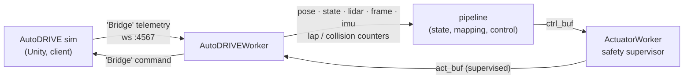

# AutoDRIVE RoboRacer simulator

pilot_core drives the AutoDRIVE RoboRacer Unity simulator directly. There is no ROS and
no external bridge: `AutoDRIVEWorker` is the server the sim connects to. Sensors go into
the usual shared buffers, and the supervised command (`ActuatorWorker`'s output: arming,
150 ms watchdog, speed cap) is sent back on every sim message.



## Setup (vast.ai box, no Docker)

```bash
scripts/vast_autodrive_setup.sh       # Xvfb :99, openbox, x11vnc, noVNC on 127.0.0.1:6080, sim builds
pip install -e ".[sim]"               # websockets
```

The script installs the stock `2026-iros` practice and compete builds under
`/workspaces/autodrive_sim`. It registers supervisor services `autodrive_xvfb`,
`autodrive_wm`, `autodrive_vnc`, `autodrive_novnc` and `autodrive_sim`, with logs under
`/workspaces/logs`. Sim settings live in `/workspaces/autodrive_sim/sim.env`
(`SIM_VARIANT`, `SIM_W`/`SIM_H`, …); change them, then run
`supervisorctl restart autodrive_sim`. To watch, run
`ssh -L 6080:127.0.0.1:6080 <box>` and open `http://localhost:6080/vnc.html`.

## Running

```bash
python start.py --config config_autodrive.yaml           # LiDAR mapping lap, then race
python scripts/autodrive_sim_ctl.py connect              # the sim has no CLI connect option
```

Keys: `a` arm, `SPACE` disarm, `r` reset the sim, `l` end the mapping lap, `q` quit.

- Once armed, `LidarGapFollower` (`track_control.mapping_drive`) drives the mapping lap.
  On the car a human drives this lap with the RC transmitter.
- `MappingWorker` closes the lap on its own (`mapping.auto_loop_close`) once the car is
  back past its start. The control mode then takes over.
- The map is saved to `maps/autodrive_practice`. To race on a saved map, set
  `enable_slam: false` and `use_saved_map: true`.
- Once a server is listening and the sim is in the connected state, the sim reconnects
  by itself. Otherwise toggle the connection with `autodrive_sim_ctl.py reconnect`.

With `--recording`, the recording directory also gets `sim_messages.csv` (one row per
message: receive and reply times, sim clock, pose, the sim's echo, the command sent and
its age) and `sim_events.jsonl` (laps with the sim's lap time, collisions, resets).

## The stock sim's protocol and behaviour, as measured

The protocol spike is `scripts/autodrive_spike.py`; the live probes are in
`scripts/autodrive_validate.py`.

- **Transport.** The sim opens `ws://host:4567/socket.io/?EIO=4&transport=websocket`
  (websocket-sharp). It sends client-side pings (`2`) and never sends a namespace
  CONNECT (`40`). It only starts streaming after the server has sent `40` and a first
  `Bridge`. python-socketio 4 rejects `EIO=4`, and 5 waits for the `40` forever, so
  pilot_core speaks this subset directly over `websockets`.
- **Rate.** The sim emits on its own clock and also re-sends its last snapshot when a
  command arrives. Only messages whose sim clock (`V1 Lap Time`) has moved are new
  frames. On a cloud GPU (vast.ai) that is 10–18 new frames/s.
- **Keys.** `V1 Throttle`, `V1 Steering`, `V1 Encoder Ticks`, `V1 Encoder Angles`,
  `V1 Position`, `V1 Orientation Quaternion` (x y z w), `V1 Orientation Euler Angles`,
  `V1 Linear Velocity`, `V1 Angular Velocity`, `V1 Linear Acceleration`,
  `V1 LIDAR Scan Rate`, `V1 LIDAR Range Array` (base64 → gzip → 1081 newline floats,
  `Infinity` = no return), `V1 Front Camera Image` (192×108 JPEG), `V1 Lap Count`,
  `V1 Lap Time` (sim clock), `V1 Last Lap Time`, `V1 Best Lap Time`, `V1 Collisions`.
  The stock build has no depth camera and no checkpoint counter.
- **Units.** `V1 Linear Velocity` is in the body frame: x is the signed speed. The
  `V1 Steering` echo is the wheel angle in rad, with ±1 mapping to ±30°.
- **Throttle is a speed set-point**, about **24.8 m/s per unit** ("Calibration" below). At
  neutral the car stops in about 0.3 s from 1.5 m/s; it does not coast. Negative
  throttle drives in reverse.
- **Reset.** A one-message `V1 Reset: True` is usually ignored, so the worker holds it
  for 0.4 s, with neutral. The Reset button on the HUD also works.
- **Collisions.** After a wall hit the sim counts a collision and puts the car back a
  short way. `MappingWorker`'s `jump_threshold` cuts those jumps out of the mapping lap.

## Calibration (`scripts/autodrive_validate.py calibrate`)

| throttle | 0.02 | 0.03 | 0.04 | 0.05 | 0.06 | 0.07 | 0.08 | 0.10 |
| -------- | ---- | ---- | ---- | ---- | ---- | ---- | ---- | ---- |
| steady-state speed (m/s) | 0.50 | 0.75 | 1.00 | 1.25 | 1.50 | 1.75 | 1.99 | 2.45 |

- **Throttle.** The fit through the origin is 24.8 m/s per unit, with a maximum residual
  of 3 cm/s. This value is `safety.speed_per_throttle`, and the speed controller's gains
  in `config_autodrive.yaml` are scaled to it.
- **Steering.** Curvature against yaw rate gives an effective wheelbase of 0.342 m
  (IQR 0.336–0.351), which is the value in `vehicle_params_roboracer.yaml`.

## Racing (`config_autodrive_compete.yaml`)

The race settings, validated on the stock `2026-iros` compete build (L40S, Low quality,
640×360), 10 laps in one run: 0 collisions, first lap 12.61 s from a standing start, then
10.53–10.71 s, 108.0 s in total. The October settings lapped it in 19.5 s.

```bash
python scripts/make_raceline.py maps/autodrive_compete --margin 0.5   # once per map
python start.py --config config_autodrive_compete.yaml               # arms itself (auto_arm)
```

- **Racing line** (`control/raceline.py`). Minimum curvature between the mapped walls,
  at least `--margin` from either wall (true nearest-wall distance, so sharp inner corners
  count). Compete track: 46.5 m centre-line → 43.9 m line; the speed planner's estimate
  goes from 10.3 s to 7.9 s per lap. The margin is 0.5 m because the car hits a wall about
  0.3 m from the mapped one; on the centre-line it ran at 0.46 m without touching.
- **Pure pursuit with a shorter lookahead** (0.5 + 0.25 v, at most 2 m). The default's
  3 m lookahead cuts the line's corners into the inside walls. The MPC weaved on the
  straight at this latency and was not used.
- **Grip.** The planner may use 10.3 m/s² of lateral acceleration
  (`lat_accel_fraction: 2.0`), but at large steering the car slides wide long before
  that: out of the hairpins and at the zig-zag apexes, into the outer wall. The speed is
  therefore also capped by the curvature actually steered, at 5 m/s²
  (`steer_speed_limit`, `steer_lat_accel`). This cap is what keeps it clean: a lower planner
  grip (down to 6 m/s²) without the cap, or the cap only above half steering, still hits
  walls. Likely cause, not measured: the sim's tyres lose lateral grip under braking or
  acceleration, which a fixed profile cannot see and the cap reacts to.
- **Collisions** put the car back a short way. The EKF used to read that jump as speed and
  yaw rate and the controller steered straight back into the wall, every respawn (2217
  collisions in one run). With `estimator.jump_reset_m` (0.4 m in the sim configs) a jump
  restarts the EKF at the new pose, standing still, and resets the controllers.
- **Re-run 2026-10-29** (scripts/autodrive_bench.py, L40S): qualifier on the practice track
  10 laps, 0 collisions, 9.19 s then 6.89-6.98 s per lap (~71.6 s); compete track 10 laps,
  0 collisions, 109.07 s (13.39 s, then 10.52-10.76 s). Against the published 2026-iros
  final (race time + 10 s per collision) that is 15th of 23: 14th 107.77 s, 1st 71.82 s
  (best lap 7.16 s).

## Known limitations

- **Sim freezes on a shared GPU.** When other jobs load the GPU, the sim freezes for up
  to several seconds; 0–90 % of wall time per run on a shared cloud GPU (`stalled_pct`). During a freeze
  its graphics thread sits in the NVIDIA kernel driver (`D` state, `os_acquire_rwlock_read`).
  The sim clock pauses with it, so its lap times stay valid. pilot_core's state goes
  stale (0.5 s), the watchdog sends neutral, and control resumes when frames return.
  Ways round it were checked and ruled out:
  - The build ships only HDRP Vulkan shaders, so `-force-glcore` fails and Mesa
    lavapipe renders magenta.
  - Fewer job workers or a lower resolution did not help.
- **No command timeout in the sim.** The sim keeps applying the last command it
  received. pilot_core sends neutral on SIGTERM / SIGINT, and also when only `start.py`
  is SIGKILLed (the orphaned link worker notices and sends neutral). If every
  pilot_core process is SIGKILLed at once, the car keeps driving its last command.
  That needs a sim-side timeout, like the firmware's 250 ms.
- **ORB-SLAM3 on the stock camera does not work.** The 192×108 front camera sits near
  the rear axle, so the car's own body fills about 55 % of the view; with that masked,
  the features left are the horizon and the edges of floor glare, which moves with the
  camera. Offline replays (`scripts/autodrive_slam_replay.py`, one lap each) at the HUD's
  Low / High / Ultra Quality, CUDA and CPU: 30–63 % of frames tracked, ATE 2.5–2.7 m over
  an 8.5 m lap, Sim(3) scale 42–67 where metric RGB-D should give 1. High and Ultra track
  more frames but are no more accurate. The HUD "Scene Light" toggle turns the light off
  (the default is on). `autodrive_sim_ctl.py quality` cycles Low → High → Ultra; the
  benchmark ran at Low.
- **Missing sensors.** Depth camera and checkpoint counters need Joshua Choi's modified
  build. The worker accepts likely key names, but they are unconfirmed.

## Benchmark (`scripts/autodrive_bench.py`)

```bash
python scripts/autodrive_bench.py run --out runs/x --laps 3 [--set dotted.key=value ...]
python scripts/autodrive_bench.py matrix bench/matrix.yaml --stage A --out bench/<date>
python scripts/autodrive_bench.py summary bench/<date>
```

A run launches `start.py` with keys piped in, connects, resets and arms the sim, then
counts laps from `sim_events.jsonl`. It scores the sim's own trajectory against the map
the controller raced on with `control.sim.score_trajectory`, plus link timing and CPU
per worker.

## Vision (`VisionWorker` in the sim)

Needs `sim_depth` (frames upscaled ×2, car body painted out, depth from the LiDAR); the
vision section of `config_autodrive.yaml` points it at the sim camera's intrinsics.
Ground truth comes from `scripts/autodrive_vision_labels.py`: a pixel is track when
the LiDAR depth adapter puts its ray on the floor before any wall and that floor point,
placed with the sim pose, lies between the mapped boundaries (car body ignored).

```bash
# record runs with sim_depth on (any controller), e.g.
python scripts/autodrive_bench.py run --out runs/v1 --laps 2 --set sim_depth.camera=sim_camera/camera.yaml \
    --set sim_depth.scale=2 --set enable_slam=false --set use_saved_map=true
python scripts/autodrive_vision_labels.py dataset runs/v*/rec/*/ --map maps/autodrive_practice --out datasets/sim_track
python scripts/train_vision.py --data datasets/sim_track --model fast_scnn --size 224 384 --epochs 40 \
    --batch-size 16 --out sim_track_seg.onnx               # GPU if available, ~13 min
python scripts/autodrive_vision_labels.py eval datasets/sim_track_compete --onnx sim_track_seg.onnx
python scripts/autodrive_vision_labels.py score <run>/rec/<ts> --map maps/autodrive_compete   # a live run
```

Trained on 4 practice-track runs (1417 images; pure_pursuit / stanley / lqr / mpc,
1.5–4.0 m/s), checked on the compete track it never saw: 926 images IoU 0.941
(precision 0.994, recall 0.946); live in `VisionWorker` (`vision.model: onnx`) over
2 laps of compete, IoU 0.939, with lap times unchanged. `ground_plane` live on practice:
IoU 0.94, but its depth is the same LiDAR adapter the labels come from, so that number
mostly checks the wiring.

### The segmentation-edge scan (no LiDAR on the car)

`seg_scan.source: segmentation` (with `vision.enabled` and `sim_depth`) makes the mapping
drive use the scan built from the mask edge (`control/seg_scan.py`) instead of the LiDAR,
as on the car. `seg_scan` in `config_autodrive.yaml` holds the sim camera's mount and its
offset behind the LiDAR. Score it offline against the LiDAR on any export:

```bash
python scripts/seg_scan_eval.py runs/x/export          # range error, missed / phantom walls, gap target
```

Results: [results.md](results.md#segmentation-edge-scan). It has not been driven live yet.

## Telemetry export and HUD

`scripts/export_recording.py` puts every buffer of a run (plus the sim screen video and
the sim's own messages) on one clock, `time.monotonic()` on the pilot_core machine, and
writes plain CSV / PNG / NPZ. `scripts/render_hud.py` then draws the synchronised HUD
at the top of the README from that export: sim view, car camera with the live
segmentation, the map growing from LiDAR with the speed-coloured trail, and
command vs. post-safety steering / throttle.

```bash
python scripts/autodrive_bench.py run --out runs/show --laps 1 --set use_saved_map=false \
    --set mapping.boundary_save_path=null --set recording_config.frame.sample_k=1 [...]
python scripts/export_recording.py runs/show --out runs/show/export
python scripts/render_hud.py runs/show/export --out hud.mp4                     # real time, 15 fps
python scripts/render_hud.py runs/show/export --out docs/images/hud.gif \
    --start 12.5 --speed 5 --fps 6 --gif-width 800                             # the README GIF
```

The export of the README run is the `telemetry-showcase` bundle ([datasets.md](datasets.md));
its `README.md` documents every file and column. Without `mapping.boundary_save_path=null`
a mapping run overwrites the committed `maps/autodrive_practice`.
