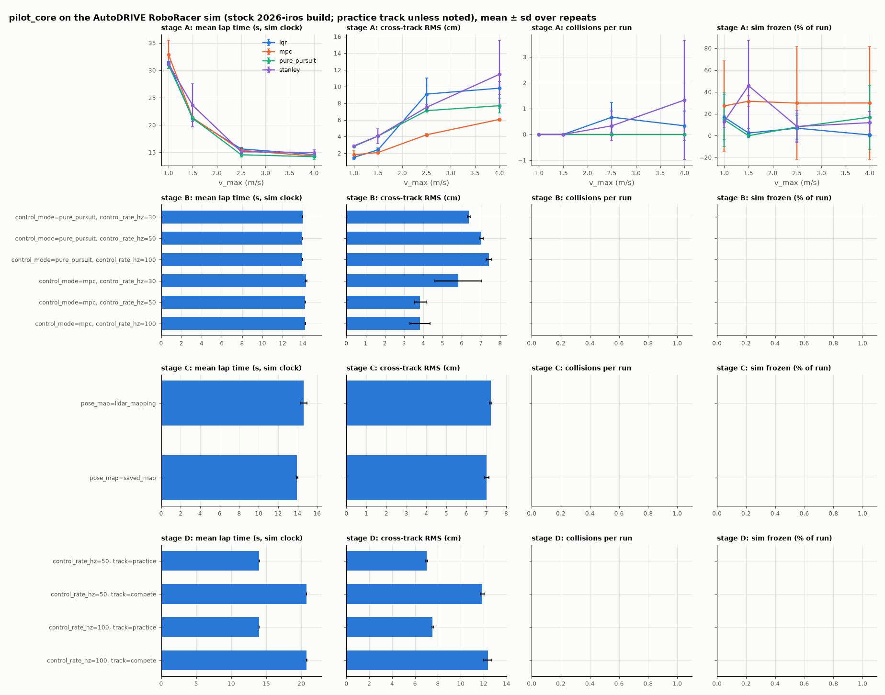

# Results

pilot_core in the stock AutoDRIVE RoboRacer `2026-iros` simulator, driving like the car: the
drivable area from the camera's segmentation, no LiDAR, no speed from the sim. The sim's pose is
ground truth unless the degraded-pose runs say otherwise; how each gap to the car is handled is
in [sim_to_real.md](sim_to_real.md). Nothing here was measured on the car.

## Racing on the camera map (2026-10-31)

10 laps on the compete build, L40S, 640×360, scored like the published final (race time + 10 s
per collision), on the map `scripts/seg_map.py` built from five recorded mapping runs
([bench/2026-10-31_autodrive_nolidar/results.md](../bench/2026-10-31_autodrive_nolidar/results.md)):

| run | collisions | first lap, then (s) | adjusted (s) |
| --- | --- | --- | --- |
| final 1 | 1 | 13.74, 11.48–12.56 | 130.64 |
| final 2 | 0 | 14.01, 11.59–12.00 | 120.04 |
| final 3 | 0 | 13.97, 11.62–12.08 | 120.46 |
| Ultra quality | 1 | 13.53, 11.52–12.68 | 129.52 |
| competition start (sim restarted, `auto_arm`, no keys) | 1 | 22.51, 11.57–12.63 | 139.53 |
| qualifier, practice track | 0 | 9.37, 7.30–7.33 | 75.21 |

Published final: 1st 71.82 s, 15th 113.19 s, 23 teams. These runs are behind 15th, and not
like-for-like: the track was known, the map came from five runs on it, and the pose is ground truth.

**Map accuracy.** Against the LiDAR-built map, used only to score it: outer wall median 0.13 m,
p90 0.30 m, max 0.51 m; inner wall 0.10 / 0.28 / 0.42 m. The thresholds were picked looking at
that distance, so the method has seen the reference.

## Mapping in the loop (2026-11-09)

The mapping lap now builds the walls itself, from an occupancy grid over the segmentation-edge
scans (`mapping.wall_source: occupancy`), then the car races 10 laps on that map
([bench/2026-11-09_live_mapping/results.md](../bench/2026-11-09_live_mapping/results.md)):

| track | map built after (s) | hits while mapping | walls vs LiDAR map, median outer / inner (m) | 10-lap race: collisions, adjusted (s) |
| --- | --- | --- | --- | --- |
| practice, 3 runs | 54.9–55.5 | 0, 0, 0 | 0.17 / 0.08 | 0, 0, 0; 76.20–76.94 |
| compete, 3 runs | 87.8–92.8 | 5, 4, 5 | 0.10–0.13 / 0.15–0.18 | 1, 4, 7; 132.20–194.06 |

The practice track maps cleanly in one lap and races like its offline map. On the compete track
every run maps, with a few hits, and the walls are as accurate as the offline map's; but the
racing lines on these maps pass 0.33–0.42 m from a wall (0.45 m on the offline map) and the races
hit the two left hairpins.

## Degraded pose (2026-11-09)

The race on the offline compete map with `sim_pose_degrade` making the sim's pose like
ORB-SLAM3's (latency, noise, a bounded bias, dropouts), and with one part switched off at a time:

| pose | collisions, 3 runs | adjusted (s) | laps after the first (s) |
| --- | --- | --- | --- |
| ground truth | 1, 0, 0 | 120.04–130.64 | 11.48–12.56 |
| noise and bias only | 0, 2, 0 | 120.94–142.52 | 11.43–12.79 |
| latency and dropouts only | 4, 12, 7 | 185.62–271.00 | 12.88–16.92 |
| everything | 15, 14, 12 | 271.52–307.65 | 13.87–18.60 |

Latency and dropouts, not noise, are what the race settings cannot take, although the estimator
already updates at the capture time and predicts to the present. The settings need tuning against
the degraded pose before they go on the car ([roadmap.md](roadmap.md#simulator)).

## Stage latency

`scripts/stage_latency.py` on the clean compete race (final 2). Frames and poses are stamped at
capture, so their column is capture to output; the pose age is that of the newest pose when each
command went out.

| stage | rate (Hz) | interval p50 / p95 (ms) | capture to output p50 / p95 / max (ms) |
| --- | --- | --- | --- |
| frame | 12.2 | 67.2 / 114.5 | 1.1 / 2.1 / 74.0 |
| pose | 24.3 | 52.4 / 58.8 | 1.2 / 2.3 / 125.4 |
| state | 47.6 | 21.0 / 21.3 | – |
| control | 47.6 | 21.0 / 21.5 | – |
| actuation | 49.8 | 20.1 / 20.1 | – |

Pose age when a command went out: p50 27.1 ms, p95 53.3 ms, max 154.0 ms. The sim delivers
its pose within about a millisecond; on the car ORB-SLAM3's tracking time and the camera transfer
come on top ([deployment.md](deployment.md#measuring-on-the-jetson) measures it on the Jetson).

## Segmentation-edge scan

The car has no LiDAR, so the mapping drive's scan is built from the drivable-track mask
(`control/seg_scan.py`). For each column it finds the edge of the drivable area, then places
it with the depth there. `scripts/seg_scan_eval.py` scored it against the sim LiDAR on 754
frames of the showcase run, using the live Fast-SCNN masks and only the beams in the
camera's view (about −33° to +36°):

| | |
| --- | --- |
| range error, LiDAR wall within 3 m | median 0.9 cm, p90 10.9 cm, p99 34.7 cm (151k beams) |
| missed walls (LiDAR return within 3 m, scan free or unknown) | 0.00 % |
| phantom walls (scan return, LiDAR > 0.5 m farther) | 0.20 % of beams |
| gap-follower target vs the LiDAR's, same view | median 0.2°, p90 0.8° |
| gap-follower target vs the full 270° LiDAR | median 5.3°, p90 11.0° |

- **Caveat.** In the stock sim the depth image is itself made from the LiDAR (`sim_depth`).
  So this checks the mask edges and the geometry, not stereo depth.
- **Real-car depth.** The OAK-D gave about 33 % valid depth in a dim room ([oakd.md](oakd.md)).
  Where an edge has no depth, it is placed by intersecting its pixel ray with the flat floor
  (`floor_fallback`).
- **Gap follower fix.** On a scan that covers only part of the circle, its smoothing turned
  the unknown beams at the edge of the view into phantom close walls. It now leaves unknown
  beams out; on all 2261 recorded LiDAR scans its output is unchanged.

## Learned components

- **Track segmentation** (Fast-SCNN, ONNX, trained on sim runs): IoU 0.941 on the
  compete track it never saw, 0.939 live in `VisionWorker`, with lap times unchanged.
- **Segmentation-edge scan** (the car's LiDAR stand-in, below).
- **PPO policy** (bicycle-model pretrain, PPO_1): zero-shot on the live sim, lap 1 in 17.58 s
  against pure_pursuit's 18.09 s at the same 2.0 m/s cap. About 30 % of live episodes
  collide, most likely because the bicycle env's collision body (circles r = 0.14 m) is
  smaller than the car. A live fine-tune of 26.5k steps did not improve this.

## What did not work

- **ORB-SLAM3 on the stock sim camera.** 30–63 % of frames tracked, ATE 2.5–2.7 m over an
  8.5 m lap, Sim(3) scale 42–67 (metric RGB-D should give 1). The 192×108 camera sits near the
  rear axle, so the car body fills about 55 % of the frame; once it is masked, the features
  left are the horizon and floor glare. It needs a camera ahead of the body with real
  depth, which Joshua Choi's build provides.
- **CPU rendering of the sim.** The build ships only HDRP Vulkan shaders, so lavapipe and
  GL are impossible, and the sim shares the NVIDIA driver with other jobs.
- **In-loop mapping on the point cloud (compete track).** The mapping lap's accumulated cloud
  was not usable on the compete track: within 15 cm of the LiDAR walls for 22–68 % of corner
  edges depending on range, and none of five mapping-drive settings closed a lap without a hit.
  This is what the occupancy grid replaced (`mapping.wall_source: occupancy`).

## Superseded: LiDAR campaign (2026-10-20)

The first validation and benchmark used the sim's LiDAR for the mapping lap and fused the sim's
speed, which pilot_core no longer does (`start.py` refuses `lidar.enabled`). Full tables:
[bench/2026-10-20/results.md](../bench/2026-10-20/results.md). The raw runs were on a cloud box
that has since been released; only the summary tables were kept.

### Validation

| check | result |
| ----- | ------ |
| Link: rates, pose, LiDAR, camera | PASS. Pose error 2.5e-7 m; 100 % of LiDAR points within 10 cm of the mapped walls |
| Disarmed hold / armed command echo | PASS / PASS |
| Steering sign / negative throttle | PASS / PASS |
| Reset | PASS, 0.0001 m from the start |
| Stop: SIGTERM or SIGKILL `start.py` | PASS / PASS. Neutral sent; the car rolled 0.34 / 0.30 m |
| Stop: SIGKILL every pilot_core process | **FAIL**. The sim has no command timeout: 8.51 m driven, 15 wall hits in 21.2 s. Needs a sim-side timeout like the firmware's 250 ms |
| Calibration | 24.80 m/s per unit throttle; effective wheelbase 0.342 m |
| Map, then race 3 laps | PASS: 0 collisions; cross-track RMS 4.1 cm |
| pytest | 357 passed, 7 skipped (all extras installed) |

### Benchmark (84 completed runs, 2 failed cells, 2 skipped; 3 repeats × 2 laps per cell)

Of the 84 completed runs, one (mpc, v_max 2.5, repeat 3) finished 1 of its 2 laps. The two
failed cells are ORB-SLAM3 as the pose source (CUDA and CPU), below.

- **Controller × v_max.** At v_max 4.0, pure_pursuit and mpc are fastest (mean lap
  14.2–14.4 s) with 0 collisions. mpc has the lowest cross-track error from 1.5 m/s up.
  Collisions happen only at v_max ≥ 2.5, with lqr and stanley; stanley at 4.0 is the worst
  cell (1.3 ± 2.3 per run). The car never reaches 4.0 m/s: its mean speed is about 2.3 m/s.
- **Loop rate, 30 / 50 / 100 Hz.** Barely matters. pure_pursuit best lap 12.89–12.90 s;
  mpc is about 0.25 s slower per lap with 3.8 cm cross-track.
- **Pose and map source.** Saved map: best lap 12.90 s. LiDAR mapping on the fly, then
  racing: 12.63 ± 0.25 s. This gap is unexplained; the two maps differ in length by only 0.2 m.
  ORB-SLAM3: **FAILED** (below).
- **Track.** Practice best lap 12.89 s; compete best lap 19.53 s; 0 collisions on both.
- **Sim stalls.** 0–89.8 % of a run's wall time in controller × v_max, when other GPU jobs
  shared the GPU; 0 % in every other stage. Each run reports `stalled_pct`.

