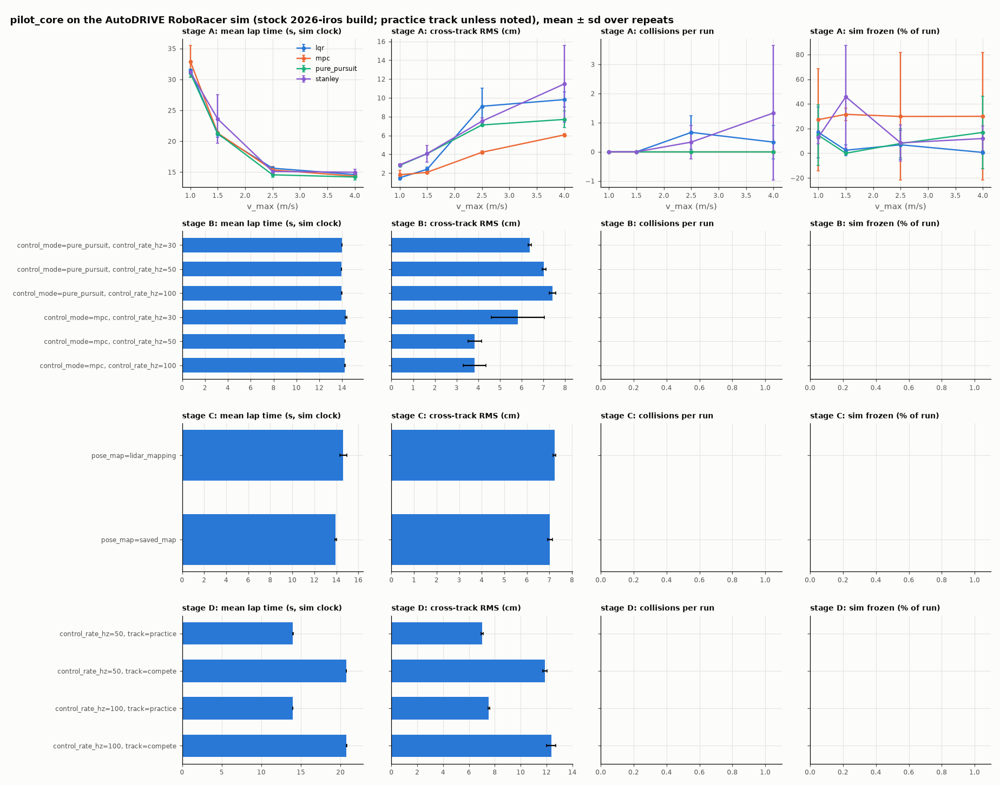

# Results: AutoDRIVE RoboRacer sim (October 2026)

pilot_core was validated end to end against the stock AutoDRIVE RoboRacer `2026-iros`
build over the direct link ([autodrive.md](autodrive.md)), then benchmarked. Sim at 640×360,
Vulkan, Low quality, on a shared-GPU cloud box. Full tables: [bench/2026-10-20/results.md](../bench/2026-10-20/results.md).

## Validation

| check | result |
| ----- | ------ |
| Link: rates, pose, LiDAR, camera | PASS. Pose error 2.5e-7 m; 100 % of LiDAR points within 10 cm of the mapped walls |
| Disarmed hold / armed command echo | PASS / PASS |
| Steering sign / negative throttle | PASS / PASS |
| Reset | PASS, 0.0001 m from the start |
| Stop: SIGTERM or SIGKILL `start.py` | PASS / PASS. Neutral sent; the car rolled 0.34 / 0.30 m |
| Stop: SIGKILL every pilot_core process | **FAIL**. The sim has no command timeout: 8.51 m driven, 15 wall hits in 21.2 s. Needs a sim-side timeout like the firmware's 250 ms |
| Calibration | 24.80 m/s per unit throttle; effective wheelbase 0.342 m |
| Map, then race 3 laps | PASS: 0 collisions; cross-track RMS 4.1 cm |
| pytest | 357 passed, 7 skipped (all extras installed) |

## Benchmark (84 runs, 0 errors; 3 repeats × 2 laps per cell)

- **Controller × v_max.** At v_max 4.0, pure_pursuit and mpc are fastest (mean lap
  14.2–14.4 s) with 0 collisions. mpc has the lowest cross-track error from 1.5 m/s up.
  Collisions happen only at v_max ≥ 2.5, with lqr and stanley; stanley at 4.0 is the worst
  cell (1.3 ± 2.3 per run). The car never reaches 4.0 m/s: its mean speed is about 2.3 m/s.
- **Loop rate, 30 / 50 / 100 Hz.** Barely matters. pure_pursuit best lap 12.89–12.90 s;
  mpc is about 0.25 s slower per lap with 3.8 cm cross-track.
- **Pose and map source.** Saved map: best lap 12.90 s. LiDAR mapping on the fly, then
  racing: 12.63 ± 0.25 s. This gap is unexplained; the two maps differ in length by only 0.2 m.
  ORB-SLAM3: **FAILED** (below).
- **Track.** Practice best lap 12.89 s; compete best lap 19.53 s; 0 collisions on both.
- **Sim stalls.** 0–89.8 % of a run's wall time in controller × v_max, when other GPU jobs
  shared the GPU; 0 % in every other stage. Each run reports `stalled_pct`.

## Learned components

- **Track segmentation** (Fast-SCNN, ONNX, trained on sim runs): IoU 0.941 on the
  compete track it never saw, 0.939 live in `VisionWorker`, with lap times unchanged.
- **Segmentation-edge scan** (the car's LiDAR stand-in, below).
- **PPO policy** (bicycle-model pretrain, PPO_1): zero-shot on the live sim, lap 1 in 17.58 s
  against pure_pursuit's 18.09 s at the same 2.0 m/s cap. About 30 % of live episodes
  collide, most likely because the bicycle env's collision body (circles r = 0.14 m) is
  smaller than the car. A live fine-tune of 26.5k steps did not improve this.

## Segmentation-edge scan

The car has no LiDAR, so the mapping drive's scan is built from the drivable-track mask
(`control/seg_scan.py`). For each column it finds the edge of the drivable area, then places
it with the depth there. `scripts/seg_scan_eval.py` scored it against the sim LiDAR on 754
frames of the showcase run, using the live Fast-SCNN masks and only the beams in the
camera's view (about −33° to +36°):

| | |
| --- | --- |
| range error, LiDAR wall within 3 m | median 0.9 cm, p90 10.9 cm, p99 34.7 cm (151k beams) |
| missed walls (LiDAR return within 3 m, scan free or unknown) | 0.00 % |
| phantom walls (scan return, LiDAR > 0.5 m farther) | 0.20 % of beams |
| gap-follower target vs the LiDAR's, same view | median 0.2°, p90 0.8° |
| gap-follower target vs the full 270° LiDAR | median 5.3°, p90 11.0° |

- **Caveat.** In the stock sim the depth image is itself made from the LiDAR (`sim_depth`).
  So this checks the mask edges and the geometry, not stereo depth.
- **Real-car depth.** The OAK-D gave about 33 % valid depth in a dim room ([oakd.md](oakd.md)).
  Where an edge has no depth, it is placed by intersecting its pixel ray with the flat floor
  (`floor_fallback`).
- **Gap follower fix.** On a scan that covers only part of the circle, its smoothing turned
  the unknown beams at the edge of the view into phantom close walls. It now leaves unknown
  beams out; on all 2261 recorded LiDAR scans its output is unchanged.

## What did not work

- **ORB-SLAM3 on the stock sim camera.** 30–63 % of frames tracked, ATE 2.5–2.7 m over an
  8.5 m lap, Sim(3) scale 42–67 (metric RGB-D should give 1). The 192×108 camera sits near the
  rear axle, so the car body fills about 55 % of the frame; once it is masked, the features
  left are the horizon and floor glare. It needs a camera ahead of the body with real
  depth, which Joshua Choi's build provides.
- **CPU rendering of the sim.** The build ships only HDRP Vulkan shaders, so lavapipe and
  GL are impossible, and the sim shares the NVIDIA driver with other jobs.

Raw runs, GIFs and logs are archived with the maintainers ([datasets.md](datasets.md)).
