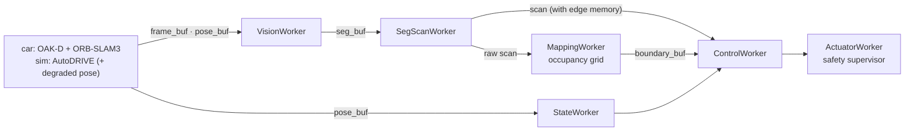

# Sim to real

pilot_core runs the same processes on the car and in the AutoDRIVE RoboRacer simulator; only
the sensor source differs (`CameraWorker` + `IMUWorker` + `SLAMWorker` on the car,
`AutoDRIVEWorker` in the sim). This page lists, axis by axis, what the sim gives, what the car
will give, the gap between them, and what the code does about it. Numbers link to the file they
come from. The car column is mostly unmeasured: nothing in this repository has yet run on the
Jetson with the current code ([roadmap.md](roadmap.md#car)).

## One pipeline

For a mapping lap, `config.yaml` (car) and `config_autodrive.yaml` (sim) build the same
segmentation, scan, mapping, control, state and actuator workers, wired the same way:
`tests/test_start_wiring.py::test_car_and_sim_map_and_drive_with_the_same_workers` fails if
they drift apart.

## Axis by axis

| axis | sim | car | gap | handled by |
| --- | --- | --- | --- | --- |
| Pose | ground truth, on time (stage latency: delivered within ~1 ms, [results.md](results.md#stage-latency)) | ORB-SLAM3 RGB-D, CUDA fork. On rendered sequences of the track: tracking p50 8.4 ms / p95 41.4 ms, ATE 0.107 m over three laps ([inertial_fix.md](../bench/2026-10-29_vio_sim/inertial_fix.md)) | late, noisy, drifting, lost in featureless stretches; not measured on the car | `sim_pose_degrade` publishes the sim pose with that latency, noise, bias and dropouts. The race settings survive the noise and bias, not the latency and dropouts ([results.md](results.md#degraded-pose-2026-11-09)); refit it from car recordings |
| Drivable area | Fast-SCNN trained on sim runs: IoU 0.941 on the unseen compete track | `ground_plane` (RANSAC floor from depth, no training) until a model trained on real frames exists | the sim model does not transfer (other sensor, mount, light) | same `VisionWorker` interface; collect and label real frames ([datasets.md](datasets.md#still-to-collect)) |
| Scan | `SegScanWorker`, 1.5 s edge memory | the same worker and memory | memory computed in each pose's own frame (Z-up sim, SLAM camera frame on the car) | `bev_axes` / `forward_axis`; `tests/test_occupancy_map.py` checks the SLAM frame |
| Edge placement | no depth: each edge where its pixel's ray meets the floor | OAK-D depth, about 33 % valid in a dim room ([oakd.md](oakd.md)) | depth holes | floor intersection where depth is missing (`floor_fallback`); needs the measured camera height and pitch |
| Walls | occupancy grid over the raw scans (`mapping.wall_source: occupancy`) | the same | none in code; not yet run on the car | offline and live mapper share `control/occupancy_map.py`; the offline map is reproduced exactly |
| Camera geometry | 192×108 upscaled to 384×216, 10.5° down, 0.17 m up | OAK-D 640×400; height 0.12 m and pitch 0 are placeholders (`config.yaml`) | unmeasured mount | SLAM fits the floor at start and logs the camera's pitch and height ([slam.md](slam.md#mapping-lap)) |
| Frame rate | camera 12 fps, pose 24 Hz | `config.yaml` asks for 30 fps; `orbslam_oakd_rgbd.yaml` says 15 | settings mismatch | regenerate with `scripts/gen_orbslam_settings.py` at the car's rate ([oakd.md](oakd.md#open-items)) |
| Vehicle model | calibrated: effective wheelbase 0.342 m, 24.8 m/s per unit throttle ([autodrive.md](autodrive.md#calibration-scriptsautodrive_validatepy-calibrate)) | F1TENTH placeholders, 3.0 m/s per unit uncalibrated | unmeasured car | calibrate before driving (README, "Before driving") |
| Speed and yaw rate | no sim speed; `PoseEKF` from poses | the same, or `ImuEKF` on the rear IMU | yaw rate from poses is 33–41 deg/s RMS off ([rear_imu_fusion.md](../bench/2026-10-29_vio_sim/rear_imu_fusion.md)) | `pure_pursuit` (no yaw rate) is the car's controller; `lqr` / `mpc` stay sim-only until the rear-IMU estimator is driven |
| Safety | supervisor in `ActuatorWorker`: neutral until armed, 150 ms command watchdog, 1.5 m/s cap, slew limits | the same, plus the firmware's 250 ms timeout and RC override | the firmware path has not been compiled or bench-tested; the sim has no command timeout of its own | bench test in `firmware/README.md`; the sim gets neutral from pilot_core on SIGTERM / SIGINT |
| Compute | L40S GPU, 12 CPU cores | Jetson Orin | everything runs in less headroom; not measured | `scripts/stage_latency.py` and `scripts/jetson_selftest.py` ([deployment.md](deployment.md)) |

## What has been shown, and what has not

Shown in the sim, camera only: the mapping lap's walls from the occupancy grid, and racing on
camera-built maps ([results.md](results.md)). Shown on the bench: the OAK-D's depth and IMU
streams on a development PC ([oakd.md](oakd.md)), and CUDA ORB-SLAM3 on TUM RGB-D at 8.0–8.7 ms
per frame on an RTX 4080 ([slam.md](slam.md)).

Not yet shown: anything on the Jetson with this code, a real-track segmentation model, ORB-SLAM3
on real track recordings, and an autonomous lap of the real car. The [roadmap](roadmap.md#car)
orders those steps.
